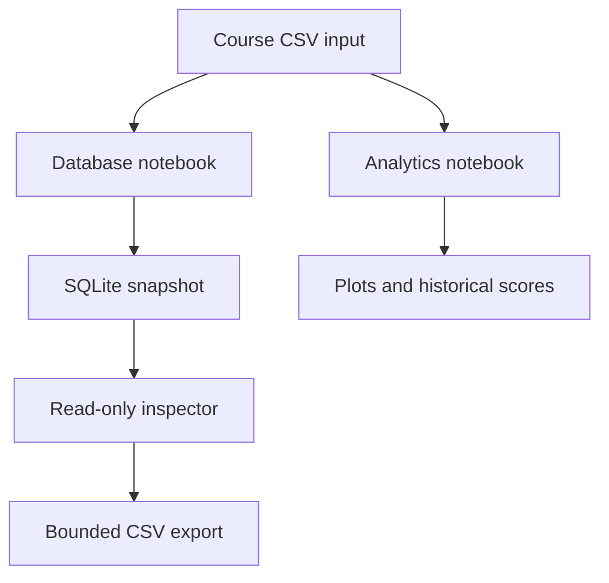

# Engineering and reproducibility runbook

## Architecture in the repository

The original notebook is a sequential local database workflow, not a web service. It imports course data, mutates SQLite tables and stores derived summaries. The analytics notebook reads a CSV and successively writes its preprocessed CSV. Saved notebook outputs and the database are historical artefacts. The 2026 inspector provides a separate standard-library read path that leaves the supplied database unchanged.

## Safe run sequence

1. Keep the downloaded archive unchanged and create a separate working copy.
2. Run `python scripts/inspect_database.py` first. It reports actual table names, row counts and columns without writing to SQLite.
3. If source CSV access is unavailable, use `--table CarSharingBackup --output CarSharing-extract.csv --limit 10000` to reconstruct rows from the committed backup. Label it as a reconstruction.
4. Open notebooks in the working copy with Jupyter. Replace the historical absolute input path with your reconstructed CSV path or a legitimate copy of the original course data.
5. Execute cells in order. The database notebook drops/recreates tables and the analytics notebook repeatedly overwrites `CarSharingDataAnalytics.csv`; rerunning isolated cells can use stale state or duplicate transformations.
6. Keep generated outputs outside the evidence archive and record input hashes, package versions and executed cells when publishing new results.

The original KLE CSV has been located privately, but its licence is not verified. It is not added as a new public dataset. Do not describe a reconstruction as an original download or broaden third-party data permissions.

## Dependencies and compatibility

The safe inspector needs only Python 3.12's standard library. Notebook browsing and the database notebook require Jupyter and pandas. Full analytics also imports NumPy, scikit-learn, statsmodels, seaborn, matplotlib, pmdarima and TensorFlow. The original environment was not locked, and the full combination has not been recreated here. Use a separate environment and compatible releases for your platform; pmdarima/NumPy and TensorFlow/Python binary compatibility need particular attention. Do not install a large ML stack merely to inspect the SQLite snapshot.

## Data integrity and SQL boundaries

`connect_readonly()` resolves an existing path strictly and opens a `mode=ro` SQLite URI. A missing path raises an error instead of silently creating an empty database. Table exports accept only names from the actual schema, quote identifiers, bind the limit and create output files exclusively. Limits are between 1 and 100,000 rows. Neither the inspector nor the tests migrate or rebuild the coursework database.

The notebook's temperature extraction lacks a stable row key in the derived table, so do not assume it is a general-purpose normalised production schema. Saved summary tables may reflect the historical execution order. Recompute a result from the backup in a working database before treating it as current analytics.

## Verification performed on 14 November 2026

The existing two inspector regressions passed with Python 3.11 on Windows. They cover quoted identifiers, bounded exports, exclusive output creation, rejection of unknown tables, SQL write rejection, byte-preserving inspection and missing-file behaviour. A temporary-database fixture originally left its transaction context's connection open; explicitly closing it fixes Windows cleanup without changing production behaviour.

The actual database matched the committed Git blob and was inspected read-only: 14 tables, 8,708 rows in both the working and backup demand tables. Its SHA-256 remained `fb135952ce82f36ab51f414f815d226e8129a8feab594ffef4abc0fc565b2401`. Notebook JSON and Python code-cell syntax were checked separately. Full notebook execution, TensorFlow training and any new accuracy comparison were not performed.

## Future changes and recovery

For a maintained analytics package, separate source loading, schema validation, transformations and evaluation rather than relying on cell order. Retain an immutable raw snapshot and key joins explicitly. Fit preprocessing inside the training fold, use chronological evaluation and state target units in reports. SQLite is adequate for this coursework size; introduce a database service only for measured concurrency or operational requirements.

Rollback code with a normal Git revert. Restore data from an independent copy because reverting code does not undo notebook mutations. Preserve migration manifests and imported snapshots byte-for-byte. Record privacy-reviewed evidence hashes in `docs/original/PROVENANCE.json`; head-file removal does not erase prior Git versions.
